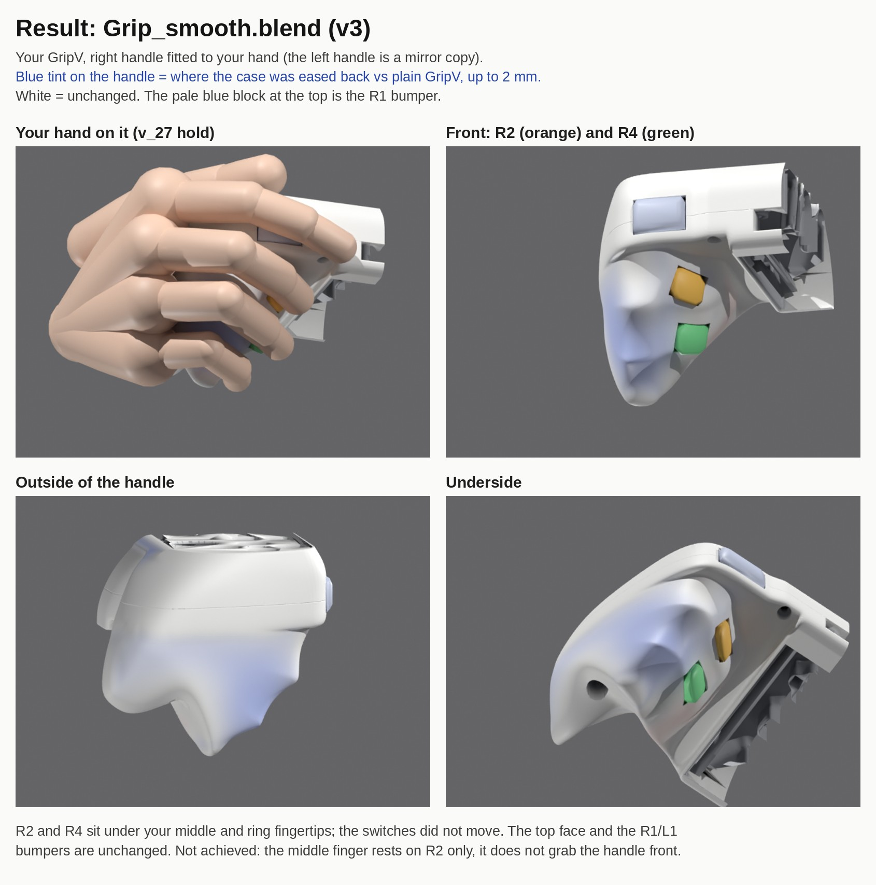

# Smooth hand fit for GripV (v3)

Olex's GripV case generator (a copy of `Grip.blend` from oleroma/Grip, set to GripV) with the right handle fitted to Olex's hand and mirrored to the left. Built on 2026-10-19/20.



## Open it

`final/Grip_smooth.blend` (Blender 5.2, 25 MB). The fit is the geometry-nodes modifier 'hand fit' on 'basemesh GripV', right after 'subdivision surface', so every case part follows it. The controls are in 'GripV controls', frame HAND FIT. The hand ('hand rig' and 'hand points') is in the GripV scene.

- How to use it: [final/GUIDE.md](final/GUIDE.md)
- Why it is built this way, and all measurements: [DESIGN.md](DESIGN.md)
- The last measured check run: `final/runs/v3_check/` (report.json, spec_v2.json, relief.json)

## What it does, compared with plain GripV

- R2 and R4 sit where the middle and ring fingertips land. The PCB switches don't move; only the trigger values change.
- The back edge of the top face is 6.6 mm closer to the sticks, which makes room for the base of the thumb.
- The handle is eased back by up to 2 mm where the palm and pinky pressed hardest. The change is one broad, smooth offset (no grooves, no bumps or dents of 1 mm or more).
- The fingertips stay at least 0.3 mm clear of the case beside the R2/R4 openings through the whole trigger press.
- The top face, R1/L1, case_top and the middle plate are unchanged, and every part is wound outward.

Not achieved: the middle finger rests on R2 only. In the v_27 pose it sits about 5 mm in front of GripV's ledge under the top plate, which no smooth case shape can reach (a test that unfroze that band is described in DESIGN.md and was not kept).

## Running the code

The scripts are kept exactly as they ran in Claude's cloud environment: Blender 5.2.2 as the pip `bpy` wheel with numpy and scipy, at fixed paths under `/tmp/claude-0/`. They do not run in Blender's own Python on Windows (no scipy there). To restore that environment, copy this folder to `/tmp/claude-0/sdf/smooth/` and use that venv's Python, for example:

```
/tmp/claude-0/venv/bin/python /tmp/claude-0/sdf/smooth/final/refit.py -- --blend /tmp/claude-0/sdf/smooth/final/Grip_smooth.blend --triggers
```

`refit.py` re-solves the triggers and the shape after the hand is re-posed, and stops without touching the file when a trigger check fails. `check.py` measures a file and renders a sheet; it regenerates its reference runs, which are not stored here. Some setup scripts also refer to earlier intermediate files that are not stored (base.blend, baseline/nofit, build/Grip_hand.blend).

| Path | What |
|---|---|
| `final/refit.py`, `final/fit_opts.json` | re-fit after re-posing the hand or changing a control |
| `final/check.py`, `final/export_check.py` | measurement and export check |
| `final/stage/` | builds the 'hand fit' modifier, evaluates the generator, trigger solver |
| `final/modules/mod_shape.py` | the shape module of the stage |
| `final/solver_v2/` | the low-frequency shape solver used by v3 |
| `final/solver/` | the earlier dense solver (v1), kept for reference |
| `final/lib_v2/`, `lib/` | shared metrics (contacts, relief, curvature, invariants) |
| `final/solve/` | the solved v3 shape and its inputs |
| `PROBLEM.md`, `targets.*`, `make_targets.py` | the problem statement and the hand targets |

Grip_smooth.blend is derived from Olex's Grip.blend, so the oleroma/Grip licence (CC BY-NC-SA) applies to it.
